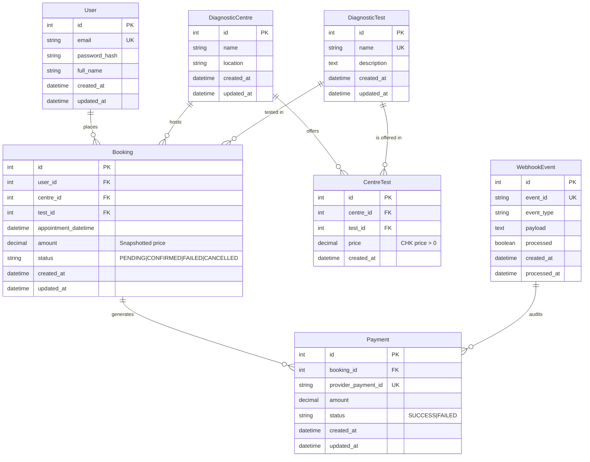
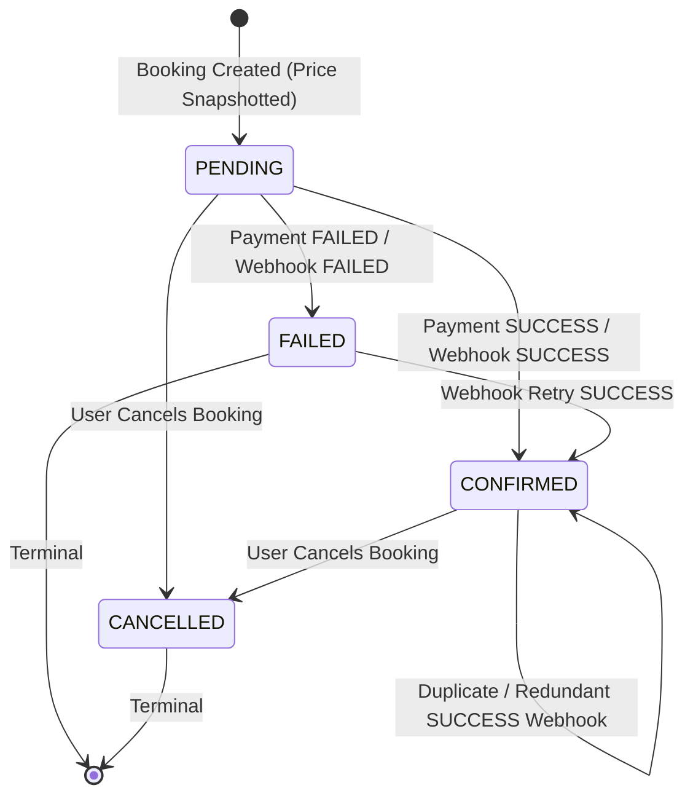
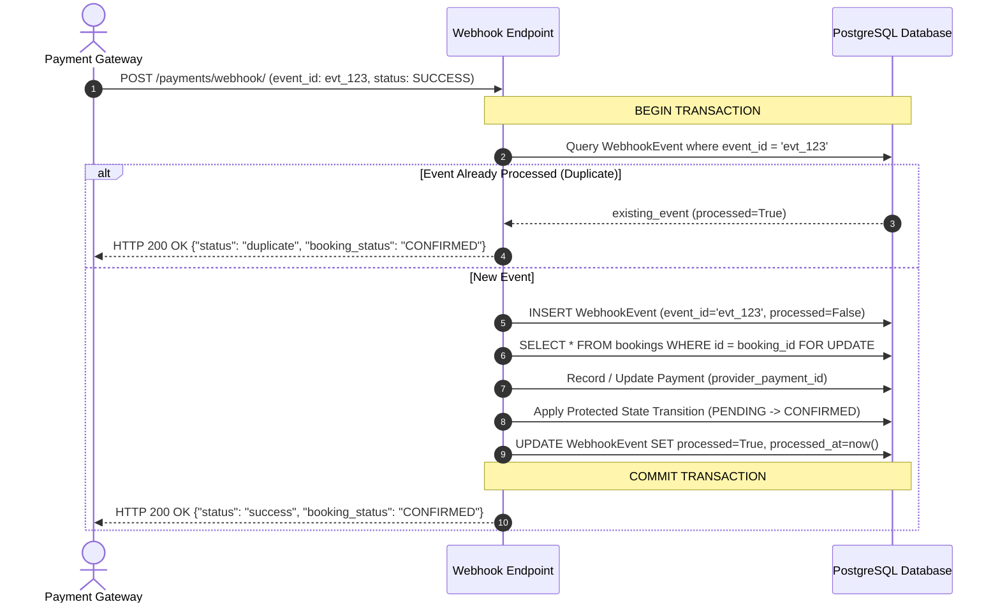

# EVE Healthcare Backend Service

[](https://www.python.org/)
[](https://fastapi.tiangolo.com/)
[](https://www.sqlalchemy.org/)
[](https://www.postgresql.org/)
[](https://www.docker.com/)
[-brightgreen.svg)]()

A production-grade, clean-architecture backend service built for **EVE Healthcare** managing diagnostic centre catalogues, test pricing, authenticated appointment bookings, simulated payment processing, and **strictly idempotent payment webhooks**.

---

## Table of Contents

1. [System Overview](#system-overview)
2. [Architecture & Design Principles](#architecture--design-principles)
3. [Technology Stack](#technology-stack)
4. [Database Design & ERD](#database-design--erd)
5. [Booking State Machine & Transition Rules](#booking-state-machine--transition-rules)
6. [Payment Flow & Webhook Idempotency Strategy](#payment-flow--webhook-idempotency-strategy)
7. [Getting Started (Local & Docker)](#getting-started-local--docker)
8. [Database Migrations & Seed Data](#database-migrations--seed-data)
9. [API Documentation & cURL Examples](#api-documentation--curl-examples)
10. [Error Handling & Security](#error-handling--security)
11. [Testing & Verification](#testing--verification)
12. [Engineering Assumptions & Future Enhancements](#engineering-assumptions--future-enhancements)

---

## System Overview

The EVE Healthcare backend provides a complete diagnostic test booking platform:
- **Authentication & Security**: Email/password registration, bcrypt password hashing, and stateless JWT Bearer token authentication with strict user ownership enforcement.
- **Diagnostic Catalogues & Flexible Pricing**: Centralised test definitions where individual diagnostic centres offer specific tests at centre-customised prices.
- **Appointment Booking Lifecycle**: Real-time snapshotting of centre-test prices at booking time, future-date appointment validation, and robust cancellation controls.
- **Simulated Payment Gateway**: Deterministic payment simulation allowing clients to test `SUCCESS` and `FAILED` scenarios.
- **Strictly Idempotent Webhooks**: Payment provider webhook processing protected by database-level unique constraints, deduplication tables, transactional atomicity, and state protection against out-of-order stale events.

---

## Architecture & Design Principles

The application is structured following a **layered Clean Architecture**:

```
app/
├── main.py                 # FastAPI application initialization & middleware
├── core/
│   ├── config.py           # Pydantic v2 settings & environment configuration
│   ├── database.py         # SQLAlchemy engine, session maker & lifecycle
│   ├── security.py         # Bcrypt hashing & JWT token encode/decode
│   ├── exceptions.py       # Custom HTTP/domain exception definitions
│   └── logging.py          # Structured logging configuration
├── models/                 # SQLAlchemy 2.0 ORM database models
│   ├── base.py             # Timestamp mixins and declarative base
│   ├── user.py             # User entity
│   ├── diagnostic_centre.py# Diagnostic centre entity
│   ├── diagnostic_test.py  # Diagnostic test catalogue entity
│   ├── centre_test.py      # Many-to-many centre-to-test pricing table
│   ├── booking.py          # Appointment booking & status enum
│   ├── payment.py          # Payment transaction records
│   └── webhook_event.py    # Idempotency event log
├── schemas/                # Pydantic v2 validation & response DTOs
│   ├── auth.py
│   ├── user.py
│   ├── diagnostic_centre.py
│   ├── diagnostic_test.py
│   ├── centre_test.py
│   ├── booking.py
│   ├── payment.py
│   ├── webhook.py
│   └── health.py
├── api/                    # Thin REST API route controllers
│   ├── dependencies.py     # JWT extraction & current user resolver
│   ├── auth.py
│   ├── centres.py
│   ├── tests.py
│   ├── bookings.py
│   ├── payments.py
│   └── health.py
├── services/               # Centralized domain & business logic
│   ├── auth_service.py
│   ├── centre_service.py
│   ├── booking_service.py
│   ├── payment_service.py
│   └── webhook_service.py
└── db/
    └── seed.py             # Sample dataset seeder
```

### Architectural Highlights
- **Thin Controllers, Rich Services**: API route handlers only handle request parameter parsing and response mapping; all business validations, database queries, and state transitions reside inside service classes.
- **Model / Schema Separation**: Database entities are strictly segregated from API contracts to avoid leaking internal attributes (like password hashes).
- **Zero Raw Plaintext Passwords**: Passwords are validated for length and complexity before being hashed with `bcrypt` (12 rounds).

---

## Technology Stack

| Component | Technology | Version | Rationale |
| :--- | :--- | :--- | :--- |
| **Language** | Python | 3.12+ / 3.13 | Type hinting, modern async ecosystem, performance |
| **Framework** | FastAPI | 0.115+ | High performance, native OpenAPI generation, dependency injection |
| **ORM** | SQLAlchemy | 2.0+ | Modern 2.0 typed syntax, unit-of-work pattern, enterprise stability |
| **Database** | PostgreSQL / SQLite | 16 (PG) | Normalized relational model, ACID compliance, constraints |
| **Migrations** | Alembic | 1.14+ | Schema version control and automated migration diffing |
| **Validation** | Pydantic v2 | 2.10+ | Fast Rust-based parsing, strict schema validation |
| **Security** | PyJWT + Bcrypt | 2.10+ / 4.2+ | Secure JWT Bearer tokens and industry-standard password hashing |
| **Testing** | Pytest + HTTPX | 8.3+ / 0.28+ | Deterministic unit and integration test suite |
| **Container** | Docker & Compose | Multi-stage | Reproducible runtime with isolated PostgreSQL container |

---

## Database Design & ERD

The database schema is fully normalized in 3NF with foreign keys, cascading rules, unique constraints, and performance indexes.



### Key Database Constraints & Indexes
1. `users(email)`: Unique index (normalized lowercase).
2. `centre_tests(centre_id, test_id)`: Unique constraint ensuring a test is mapped once per centre.
3. `centre_tests.price`: Database check constraint `price > 0`.
4. `payments(provider_payment_id)`: Unique index preventing duplicate transaction records.
5. `webhook_events(event_id)`: Unique index guaranteeing event-level deduplication.
6. `bookings(user_id, status, appointment_datetime)`: Indexed for high-throughput query performance.

---

## Booking State Machine & Transition Rules

To prevent data corruption and race conditions, booking status transitions follow strict deterministic rules:



### State Protection Rules
- **Price Freeze**: The booking amount is permanently frozen at creation time by reading `CentreTest.price`. Later price modifications at the diagnostic centre do NOT retroactively alter existing bookings.
- **Finalized State Guard**: An already `CONFIRMED` booking **cannot** be downgraded to `FAILED` by a late or out-of-order failed webhook event.
- **Terminal Cancellation**: A `CANCELLED` booking cannot be re-activated or paid for.

---

## Payment Flow & Webhook Idempotency Strategy

Payment webhooks from third-party gateways (e.g., Stripe, Razorpay) are notoriously subject to network retries, duplicate deliveries, and out-of-order delivery.



### How Webhook Idempotency is Guaranteed
1. **Primary Deduplication Table**: `webhook_events` stores each incoming event's unique ID.
2. **Database UNIQUE Constraint on `event_id`**: If concurrent webhook deliveries race simultaneously, PostgreSQL's unique constraint triggers an `IntegrityError` on the second transaction, which safely rolls back and returns the idempotent `duplicate` response.
3. **Provider Payment ID Deduplication**: The `payments` table has a `provider_payment_id` unique index to guarantee no duplicate ledger entries are created.
4. **Tested Repeated Delivery**: The automated test suite explicitly tests sending the identical webhook 10 times consecutively, validating that exactly 1 payment record exists and booking state remains intact.

---

## Getting Started (Local & Docker)

### Option 1: Run with Docker Compose (Recommended)

Make sure you have Docker and Docker Compose installed, then execute:

```bash
# 1. Clone the repository
git clone https://github.com/your-username/eve-healthcare-backend.git
cd eve-healthcare-backend

# 2. Start PostgreSQL and the FastAPI Backend
docker-compose up --build
```

The server will automatically run migrations, seed sample data, and listen on **`http://localhost:8000`**.
- Interactive Swagger UI: **`http://localhost:8000/docs`**
- ReDoc UI: **`http://localhost:8000/redoc`**
- Health Check: **`http://localhost:8000/health`**

---

### Option 2: Local Python Environment

#### 1. Prerequisites
- Python 3.12+ (or Python 3.13)
- PostgreSQL (or standalone SQLite default)

#### 2. Setup Virtual Environment
```bash
# Create virtual environment
python -m venv .venv

# Activate virtual environment
# On Linux/macOS:
source .venv/bin/activate
# On Windows (PowerShell):
.\.venv\Scripts\Activate.ps1
```

#### 3. Install Dependencies
```bash
pip install --upgrade pip
pip install -r requirements.txt
```

#### 4. Configure Environment Variables
Copy `.env.example` to `.env`:
```bash
cp .env.example .env
```

#### 5. Apply Migrations & Seed Data
```bash
# Run Alembic migrations to create tables
alembic upgrade head

# Seed initial diagnostic centres, tests, pricing, and demo user
python -m app.db.seed
```

#### 6. Start the Server
```bash
uvicorn app.main:app --host 0.0.0.0 --port 8000 --reload
```

---

## Database Migrations & Seed Data

### Migrations (Alembic)
To create a new migration after modifying models:
```bash
alembic revision --autogenerate -m "Add new column"
```
To apply migrations:
```bash
alembic upgrade head
```

### Pre-Seeded Sample Data
The `python -m app.db.seed` command creates:
- **Demo User**: `patient@example.com` / `DemoPassword123!`
- **Centres**: Apollo Diagnostic Centre (Mumbai), Metropolis Healthcare (Bangalore), Suburban Diagnostics (Delhi), SRL Diagnostics (Hyderabad).
- **Tests**: Complete Blood Count (CBC), Lipid Profile, Thyroid Profile, Vitamin D, HbA1c, Liver Function Test (LFT).
- **Centre Pricing**: Specific realistic pricing for each centre-test combination.

---

## API Documentation & cURL Examples

### 1. Health Check
```bash
curl -X GET "http://localhost:8000/health"
```
**Response (200 OK)**:
```json
{
  "status": "ok",
  "database": "connected",
  "version": "1.0.0",
  "timestamp": "2026-09-28T17:43:49.000000Z"
}
```

---

### 2. User Signup
```bash
curl -X POST "http://localhost:8000/auth/signup" \
  -H "Content-Type: application/json" \
  -d '{
    "email": "sarah.connor@example.com",
    "password": "StrongPassword123!",
    "full_name": "Sarah Connor"
  }'
```
**Response (201 Created)**:
```json
{
  "id": 1,
  "email": "sarah.connor@example.com",
  "full_name": "Sarah Connor",
  "created_at": "2026-09-28T17:40:00Z",
  "updated_at": "2026-09-28T17:40:00Z"
}
```

---

### 3. User Login (Obtain JWT)
```bash
curl -X POST "http://localhost:8000/auth/login" \
  -H "Content-Type: application/json" \
  -d '{
    "email": "sarah.connor@example.com",
    "password": "StrongPassword123!"
  }'
```
**Response (200 OK)**:
```json
{
  "access_token": "eyJhbGciOiJIUzI1NiIsIn...",
  "token_type": "bearer"
}
```

---

### 4. Diagnostic Centres & Tests

#### List All Centres
```bash
curl -X GET "http://localhost:8000/centres/"
```

#### Get Specific Centre Tests & Pricing
```bash
curl -X GET "http://localhost:8000/centres/1/tests"
```
**Response (200 OK)**:
```json
[
  {
    "id": 1,
    "centre_id": 1,
    "test_id": 1,
    "price": "450.00",
    "created_at": "2026-09-28T17:41:18Z",
    "test": {
      "id": 1,
      "name": "Complete Blood Count (CBC)",
      "description": "Measures red blood cells, white blood cells, and platelets."
    }
  }
]
```

---

### 5. Create an Appointment Booking
```bash
curl -X POST "http://localhost:8000/bookings/" \
  -H "Authorization: Bearer <YOUR_JWT_TOKEN>" \
  -H "Content-Type: application/json" \
  -d '{
    "centre_id": 1,
    "test_id": 1,
    "appointment_datetime": "2026-10-15T10:30:00Z"
  }'
```
**Response (201 Created)**:
```json
{
  "id": 1,
  "user_id": 1,
  "centre_id": 1,
  "test_id": 1,
  "appointment_datetime": "2026-10-15T10:30:00Z",
  "amount": "450.00",
  "status": "PENDING",
  "created_at": "2026-09-28T17:42:00Z",
  "updated_at": "2026-09-28T17:42:00Z"
}
```

---

### 6. Simulated Payment (Success / Failure)
```bash
curl -X POST "http://localhost:8000/payments/" \
  -H "Authorization: Bearer <YOUR_JWT_TOKEN>" \
  -H "Content-Type: application/json" \
  -d '{
    "booking_id": 1,
    "simulate_result": "SUCCESS"
  }'
```
**Response (201 Created)**:
```json
{
  "id": 1,
  "booking_id": 1,
  "provider_payment_id": "sim_pay_56a4d4060d104a77",
  "amount": "450.00",
  "status": "SUCCESS",
  "created_at": "2026-09-28T17:43:49Z"
}
```

---

### 7. Ingest Payment Gateway Webhook (Idempotent)
```bash
curl -X POST "http://localhost:8000/payments/webhook/" \
  -H "Content-Type: application/json" \
  -d '{
    "event_id": "evt_gateway_998877",
    "event_type": "payment.updated",
    "payment_id": "pay_stripe_112233",
    "booking_id": 1,
    "status": "SUCCESS",
    "amount": 450.00
  }'
```
**Response (200 OK)**:
```json
{
  "status": "success",
  "message": "Webhook event processed successfully.",
  "event_id": "evt_gateway_998877",
  "booking_id": 1,
  "booking_status": "CONFIRMED"
}
```
*If this exact request is resent:*
```json
{
  "status": "duplicate",
  "message": "Webhook event has already been processed.",
  "event_id": "evt_gateway_998877",
  "booking_id": 1,
  "booking_status": "CONFIRMED"
}
```

---

### 8. Cancel a Booking
```bash
curl -X POST "http://localhost:8000/bookings/1/cancel" \
  -H "Authorization: Bearer <YOUR_JWT_TOKEN>"
```
**Response (200 OK)**:
```json
{
  "id": 1,
  "status": "CANCELLED",
  "message": "Booking has been successfully cancelled."
}
```

---

## Error Handling & Security

### Uniform Error Response Format
All error responses return structured JSON messages:
```json
{
  "detail": "Diagnostic test 'Thyroid Profile' is not offered at centre 'Apollo Diagnostic Centre'."
}
```

| HTTP Status Code | Scenario |
| :--- | :--- |
| `400 Bad Request` | Business rule violations (test not offered at centre, invalid state transitions, duplicate cancellations) |
| `401 Unauthorized` | Missing, expired, or invalid JWT Bearer token / wrong credentials |
| `403 Forbidden` | Authenticated user attempting to access or pay for another patient's booking |
| `404 Not Found` | Non-existent diagnostic centre, test, or booking resource |
| `409 Conflict` | Duplicate email registration or resource conflict |
| `422 Unprocessable Content` | Schema validation error (past appointment dates, malformed JSON, invalid email formats) |
| `500 Internal Server Error` | Unexpected server failures with stack traces hidden from clients and logged internally |

---

## Testing & Verification

The repository includes a comprehensive, deterministic automated test suite using `pytest` and `fastapi.testclient.TestClient`.

### Running Automated Tests
```bash
pytest -v
```

### Test Coverage Summary (43/43 Passed - 100%)
- **Authentication**: Signup validation, duplicate email prevention, password hashing, lowercase email normalization, token expiration, forged JWT rejection.
- **Centres & Tests**: Retrieval, non-existent 404 handling, location-specific test pricing matrices.
- **Bookings**: Price freezing, future date validation, past-date rejection, user booking isolation, unauthorized cross-user access rejection (403 Forbidden), stateful cancellations.
- **Payments**: Simulated `SUCCESS` and `FAILED` outcomes, unauthorized payment prevention, invalid state prevention (cannot pay for cancelled or already confirmed bookings).
- **Webhooks & Idempotency**:
  - `test_webhook_idempotency_10_repeated_calls`: Sends the identical webhook 10 consecutive times to verify zero duplicate payments and state stability.
  - `test_webhook_stale_failed_after_confirmed_protection`: Validates that delayed failure webhooks do not corrupt already confirmed bookings.
  - Cancelled booking safety.

### Running End-to-End Verification Script
```bash
python -m scripts.e2e_verification
```

---

## Engineering Assumptions & Future Enhancements

### Assumptions Made
1. **One User = One Patient Account**: A single authenticated user acts as the patient for the created booking.
2. **Deterministic Simulation**: Payment gateway behavior is simulated locally without communicating with real external banking APIs.
3. **Price Snapshotting**: The price charged for a booking is locked at the instant the booking is created based on the `centre_tests` table.
4. **Timezone Handling**: All appointment datetimes are standardized to UTC.
5. **Authorization Strategy**: A user attempting to view or pay for another user's booking receives a `403 Forbidden` error (explicitly signaling unauthorized access).

### Future Roadmap
- **Redis Caching**: Cache diagnostic centres and test catalogues with TTL-based invalidation.
- **Asynchronous Task Queue (Celery / ARQ)**: Asynchronous email and SMS appointment reminder dispatch.
- **Slot Capacity Management**: Real-time diagnostic centre appointment slot availability limits per hour.
- **Webhook Signature Verification**: HMAC SHA-256 signature verification for webhook payloads from specific providers (e.g. Stripe webhook signatures).
